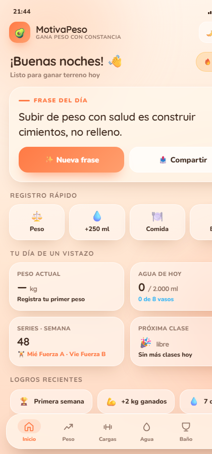

# MotivaPeso

Esto lo hice para mí, la verdad. Es una app para no perderle el seguimiento al peso cuando andas tratando de ganar masa: el peso, el agua, lo que comes, el entrenamiento y esas cosas que se te olvidan a mitad de semana.

La interfaz es una página HTML que metí dentro de una app Android bien liviana, ocupa menos de 3 MB. Funciona en celulares viejos, tiene modo oscuro y también un modo ligero por si tu teléfono va lento.

## Así se ve

## Bajarla

**[Descargar MotivaPeso v2.4](https://github.com/magdalenagonzalez08/motivapeso/releases/latest)**

Ábrela en el celular y dale a instalar. Si el teléfono avisa que es una app de fuente desconocida, es normal: no está en Play Store. Dale a "instalar de todos modos" y listo.

Si ya tienes la 2.3 o anterior, instala encima. El paquete y la firma son los mismos, así que se actualiza sin borrar tus registros.

## Actualizaciones

La app revisa sola si hay una versión nueva en GitHub (una vez al día) y te lo avisa en **Ajustes → Actualizaciones**. Ahí mismo puedes tocar "Revisar" cuando quieras. Si hay algo nuevo, aparece el botón para descargar el APK; si no, te dice que estás al día.

## Qué tiene

- Arranca vacío a propósito: sin datos inventados, todo sale de lo que tú registras
- Primera vez que la abres: te pregunta tu peso actual, tu peso inicial y tu meta (todo editable después en Ajustes → Mis datos)
- Frases motivacionales para cuando se cae la constancia
- Gráfica del peso con anillo de progreso hacia tu meta
- Historial de peso ordenado por fecha, con la diferencia entre una medición y la anterior, y opción de editar la fecha o el valor y de borrar un registro mal puesto
- Agua y baño de días pasados: puedes rellenar un día que se te olvidó o corregir uno que quedó mal
- Mis rutinas de fuerza (A los miércoles, B los viernes) con los ejercicios, series y pesos que uso
- Vasos de agua con meta de 2 litros, historial por día y registro de la última vez que bebiste
- Registro de baño con gráfica de la semana (sí, también quería ver cuántas veces orinaba al día, sin culpa)
- Botón de "Hoy corrí o entrené" con cuánto tiempo ha pasado desde el último
- Notas de comida con hora, editables, y resumen de los últimos 7 días
- Mi horario de las dos carreras, con las clases del día y tabla semanal
- Todo en español, tema claro y oscuro, y se puede cambiar el color de la app
- Exportar la bitácora del día o el historial a un .txt en Descargas
- Aviso de versión nueva dentro de la app

## Qué cambió en la 2.4

- Ahora puedes **editar** un peso mal registrado: toca el lápiz ✎ en el historial y cambia el valor o la fecha
- El **baño** se puede corregir desde Hoy y desde Días anteriores: fecha, hora, tipo y nota
- Las **notas de comida** se pueden editar (texto, fecha y hora) y borrar, tanto las de hoy como las del historial
- El **agua** de un día también se puede borrar desde el historial, con doble toque para confirmar
- Al mover un registro a otra fecha, el historial se reordena solo y no quedan días duplicados

## Qué cambió en la 2.3

- Puedes registrar **agua de otro día** desde el historial: "＋ Otro día" o el lápiz ✎ de cada fila
- El **baño** ahora pide fecha y hora, así puedes apuntar algo de ayer
- En Baño hay una sección **Días anteriores** con el conteo de cada día y una ✕ para borrar registros viejos

## Qué cambió en la 2.2

Todo el detalle está en [CHANGELOG.md](CHANGELOG.md). Lo importante:

- El botón "Registrar peso de hoy" ya no inventa un peso: te pide el valor y la fecha
- El historial de peso ordena por fecha, sin duplicados ni datos rotos
- El historial de agua ya no guarda días vacíos ni mezcla los vasos de ayer con los de hoy
- "Restablecer todo" borra de verdad todo, incluido el historial de agua
- Exportar el .txt funciona dentro del APK

## Si quieres compilarla

Cada vez que subo cambios a la rama `main`, GitHub Actions genera el APK nuevo solo (pestaña Actions). Si empujo un tag `vX.Y`, además se publica la release con el APK adjunto.

O abre la carpeta `android` con Android Studio y dale Run. El HTML de la app vive en `prototipo/index.html` y Gradle lo toma directo, así que no hay que copiarlo a mano.

## Lo que todavía le falta

- Recordatorios de agua y comida con notificación real
- Sincronizar entre dispositivos
- Hacerla 100% nativa en Kotlin, algún día

## Licencia

MIT. Úsala, cópiala, cámbiala. Si te sirve, úsala.

Hecha por Magdalena.
